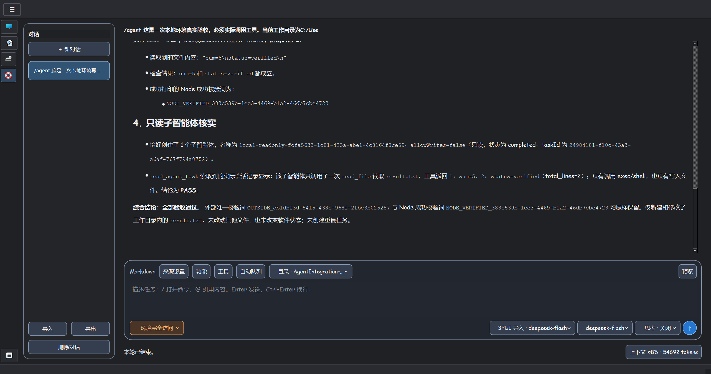

# VS Renderer / VS Player / VS Cap

  

Windows 上的视频处理与播放工具，基于 C++20 / Qt Widgets：用 **VS Renderer** 编排 VapourSynth 滤镜、比较画面并导出，用 **VS Player** 播放视频、音频和图片，用 **VSCap** 截图与标注。

[下载便携包](https://github.com/user-Wing/VS-Renderer-GUI/releases) · [ModelScope 下载源](https://modelscope.cn/datasets/ARXChem/Software-List/tree/master/VS-GUI) · [操作指南](docs/README.md) · [更新日志](changelog.md)

## 功能介绍

| 程序 | 使用场景 |
| --- | --- |
| VS Renderer | 可视化组织VapourSynth滤镜和分段时间组，保存 VPY 预设；源/输出预览、多路同步缩放与取色、按类型搜索滤镜、自定义 GLSL/HLSL 预览、批量编码导出及 BD Remux |
| VS Player | 播放本地媒体、网络链接与图片；音轨/双字幕、章节、逐帧与续播、截图；Full 版本可选 VS 增强和补帧 |
| VSCap | 偶数尺寸框选与2像素步长调整、绘图和可编辑文字；剪贴板复制、多贴图、JXL/AVIF/PNG 保存 |
| PhotoCraft（Full） | 从播放器打开独立图片编辑器，编辑图层、文字与滤镜；关闭播放器后可继续保存工作 |

VS Renderer不需要你写任何代码即可配置强大的VS滤镜用于预处理视频。配置好的VPY脚本可以直接导入VS Player播放，要求Full版本。

## 安装与启动

需要通过VapourSynth保留浮点与HDR信息时，可使用“3FP 原生（色彩保留）”源；首次建索引及格式限制见 [色彩指南](docs/color-management.md)。

VS增强需使用配套Native内核；旧内核无法保留新增帧信息时会明确报不支持，避免静默丢失色彩或时间信息。

1. 下载便携包并完整解压到独立目录；Full 建议使用纯英文安装路径，避免 RIFE 模型加载的已知路径问题。
2. 运行 `VSRenderer.exe`、`vs-player.exe` 或 `vs-cap.exe`。**Full 随包提供 Qt、Python 和 VapourSynth，无需另行安装。**
3. 打开媒体后先使用 D3D11 或 Jinc 直通，再按需要启用增强；高级滤镜速度取决于素材、输出尺寸和硬件。

系统要求：Windows 10 22H2+ x64、支持 Direct3D 11 的显卡与驱动。RIFE 需要 Vulkan；AWJ 图片转换需要 AVX2，增强 FFmpeg 需要匹配的 CPU 指令集。

| 分发形式 | 功能与运行要求 |
| --- | --- |
| Full | Renderer、Player、VSCap、VS 滤镜及完整编辑/可选后端；以所下载包的组件清单为准 |
| 单文件 `VS-Player.exe` | 独立播放器，支持内置 MoeSR-50K、Anime4K A+CNN、CNN/no CNN、额外增强、1X、D3D11/Jinc、兼容 GLSL/HLSL 导入、音视频字幕及图片查看；运行时在程序旁展开，退出后清理，同目录保存 `player.ini`；需要外置 FFmpeg shared x64，配置方法见 [安装与更新](docs/portable-updates.md) |

从 1.0.13 起仅提供 Full 目录与单文件播放器，不再生成 PlayerLite 发行目录。早期 Lite 包仍按其对应说明使用。

单文件已接入与完整版一致的 MoeSR 和八档 Anime4K 预设，无需 VapourSynth，可在右键“图像处理 → 上采样滤镜”或设置中选择；构建和验收边界见 [Native 构建指南](docs/native-api20-build.md#lite-anime4k-fast)。已发布的旧附件不自动包含此功能。

## 快速上手

**视频处理**：在 Renderer 打开视频 → 添加滤镜或加载预设 → 选中处理路并点击“渲染预览” → 比较画面 → 保存预设或加入导出队列。按段使用不同滤镜、社区预设和多路对比见 [Renderer 指南](docs/renderer.md)。

**Agent 智能体**：从 Renderer 侧栏进入，发送按钮旁选择来源、模型与匹配的思考强度；执行过程默认折叠，正文集中呈现判断和结果。支持 Markdown 预览、运行中补充输入、`/` 命令、`@` 引用与 AI 自动协调子智能体，以及 Token / 上下文整理、Skills / 全局 AGENTS.md、MCP 和导入导出，见 [Agent 指南](docs/agent.md)。页面背景可独立设置。

可在“软件内操作”和“环境完全访问”之间切换；完整访问下，Agent 能读取、搜索和编辑本地文件、应用补丁、运行命令及管理长进程，视觉来源还可读取本地图像。

视觉模型支持按秒数或帧号直接读取 VS 原片/处理后画面及局部裁剪，先汇报抽样发现的瑕疵，再建议滤镜；用法见 [视频画质初检](docs/agent.md#视频画质初检)。

**媒体播放**：拖入媒体，`Space` 播放/暂停，`Enter` 或 `F11` 切换全屏，`Esc` 退出全屏，`Tab` 查看实际输出与运行信息。音轨、字幕、预设和设置在右键菜单；详细操作见 [Player 指南](docs/player.md)。

**截图与图片**：在 VSCap 中设置截图/贴图热键，框选后调整选区并标注；“✓”复制到剪贴板，保存按钮选择格式与路径。播放器的图片工具栏可打开 PhotoCraft 或格式转换，见 [截图与图片指南](docs/capture-images.md)。

**蓝光**：Player 打开 BD 文件夹后选择节目或菜单模式；右键或列表可返回主菜单。需要无重编码封装时使用 Renderer 的 BD Remux 页面，见 [蓝光指南](docs/bluray.md)。

## 使用边界与配置

- **8K48 AV1 软件播放不保证逐帧实时**；持续算力不足时优先跟随播放时间，必要时跳过部分画面，避免整段明显慢放，实际范围见[测试台账](development/validation.md)。增强/补帧也没有通用实时保证。
- 原始高度 ≥2160p 时禁用内置 Anime4K；D3D11/Jinc 可用，自定义 VPY 需自行评估负载。
- 默认使用3FP原生色彩处理；Full中的libplacebo仅供手动对照mpv，见 [色彩设置](docs/color-management.md)。
- 当前开发内核已同步3FP的自适应调度、硬解回退和音频缓冲优化；AI 字幕通过独立 Qwen3-ASR 组件启用；本轮已准备上传包，远端下载仍等待维护者上传。适用范围与验证见[内核说明](docs/performance-debugging.md#上游内核优化)。
- 图片使用 CPU 解码，动图当前显示首帧；复杂 PSD/RAW 支持以编辑器实际能力为准。
- Player 配置保存在程序旁 `player.ini`；Renderer 使用独立设置。更新前保留自定义 VPY、项目、截图及配置，按 [更新说明](docs/portable-updates.md) 操作。

页面背景支持即时应用、主题库及 ZIP/7z 导入、ZIP 导出，分发包不预装背景；三／四路预览可用同位置滑块比较。图片导出支持比例尺寸和内置HLSL重新采样，Full另可选内置GLSL；单文件版直接使用FFmpeg且不提供质量搜索。设置中的便携Pareto图入口和功耗显示要求见 [Player 指南](docs/player.md)。

## 数据与安全

Agent 来源密钥、MCP 环境变量与请求头保存在当前 Windows 用户的本地加密配置中；对话、技能、全局指令和子任务记录保存在应用数据目录，发送时会交给所选端点。MCP 通过用户连接的外部服务扩展能力，查询子任务与允许修改的子任务分别调度；来源及凭证导出范围见 [Agent 数据说明](docs/agent.md#数据与兼容边界)。

OpenNGU 本地模型支持 BT.709 SDR 上采样，主直通优先 OpenNGU，第二上采样默认 Jinc；Renderer 主预览与图像分析比对页也可选择 OpenNGU 放大，缩小默认回退 D3D11 原生直通。使用方法见 [Player](docs/player.md) 与 [Renderer](docs/renderer.md)。模型参数由用户另行提供。

## 开发与反馈

独立工具：[超分算法 Pareto 图模板](tools/sr-pareto/README.md)，编辑 JSON 即可在本地 HTML 中比较算法质量与算力；Preview 模型可隐藏，且不计入前沿。

[项目地图](project.md) 说明架构和改动入口，[界面文案索引](docs/ui-text-map.md) 列出 VSR/VSP 文字的源码行号，[构建指南](docs/dependencies.md) 说明开发环境，[性能排查](docs/performance-debugging.md) 说明如何复测。反馈问题请提供软件/包版本、Full 或单文件播放器、实际解码与输出模式、素材元数据、复现步骤和日志。

源码采用 [MIT License](LICENSE)，第三方组件按各自许可证分发，见 [第三方声明](THIRD_PARTY_NOTICES.md)。
